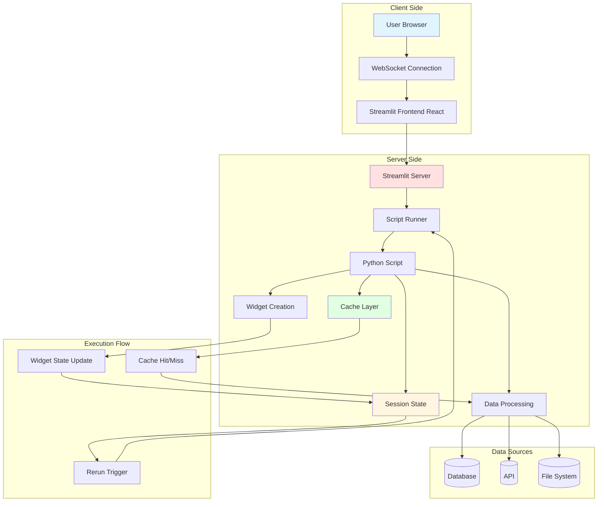

# راهنمای جامع Streamlit برای مهندسین داده و توسعه‌دهندگان Python

## فهرست مطالب

1. [معماری و موتور اجرایی](#معماری-و-موتور-اجرایی)
2. [تحلیل ماژول‌های جلسه](#تحلیل-ماژول-های-جلسه)
3. [معماری سیستم و نمودار جریان](#معماری-سیستم-و-نمودار-جریان)
4. [عیب‌یابی و ماتریس خطایابی تولید](#عیب-یابی-و-ماتریس-خطایابی-تولید)
5. [لاگ بازرسی فنی](#لاگ-بازرسی-فنی)

---

## معماری و موتور اجرایی

### چرخه حیات اجرای Top-to-Bottom

Streamlit از یک مدل اجرایی خطی استفاده می‌کند که اسکریپت را از بالا به پایین در هر تعامل کاربر اجرا می‌کند:

1. **Initial Render (رندر اولیه)**:
   - اسکریپت Python از خط اول تا آخر اجرا می‌شود
   - تمام widgetها با مقادیر پیش‌فرض ایجاد می‌شوند
   - `st.session_state` با مقادیر اولیه پر می‌شود
   - UI اولیه به کاربر ارسال می‌شود

2. **User Interaction (تعامل کاربر)**:
   - کاربر روی widget کلیک می‌کند یا مقداری را تغییر می‌دهد
   - تغییرات از طریق WebSocket به سرور ارسال می‌شود
   - Streamlit یک **rerun** (اجرای مجدد) اسکریپت را آغاز می‌کند

3. **Subsequent Rerun (اجرای مجدد بعدی)**:
   - اسکریپت دوباره از بالا به پایین اجرا می‌شود
   - widgetها با مقادیر جدید کاربر بازسازی می‌شوند
   - `st.session_state` مقادیر قبلی را حفظ می‌کند
   - UI به‌روزرسانی شده به کاربر ارسال می‌شود

### ارتباط Server-Client و WebSocket

```
Client Browser <--WebSocket--> Streamlit Server <--Python Script--> Data Sources
```

- **WebSocket**: کانال دائمی برای ارتباط دوطرفه
- **State Synchronization**: `st.session_state` بین rerunها حفظ می‌شود
- **Widget Binding**: هر widget به یک key در `st.session_state` متصل می‌شود

### Script Runner vs Session State Lifecycle

| مفهوم | چرخه حیات | استفاده |
|-------|-----------|---------|
| Local Variables | هر rerun بازسازی می‌شوند | داده‌های موقت محاسباتی |
| `st.session_state` | در طول session کاربر حفظ می‌شود | وضعیت بین rerunها |
| `@st.cache_data` | تا زمان تغییر ورودی یا TTL | داده‌های سنگین و queryها |
| `@st.cache_resource` | تا زمان تغییر ورودی یا TTL | connections و engineها |

### Rerun Triggers

1. **Widget Interaction**: کلیک دکمه، تغییر slider، انتخاب option
2. **st.rerun()**: فراخوانی صریح rerun
3. **Form Submission**: submit_button در st.form
4. **Callback Execution**: on_click callback پس از اجرا rerun را فعال می‌کند

---

## تحلیل ماژول‌های جلسه

### Session 1: مولفه‌های UI پایه (`session1/app.py`)

#### تعریف معماری و مسئله اصلی

**چرا این ماژول در Data Engineering ضروری است؟**

- نمایش وضعیت اجرای jobهای ETL
- ارائه metadata محیط به تیم عملیاتی
- نمایش reference queryها برای تحلیل‌گران داده

#### شکست کامل متدها

##### `st.set_page_config()`

```python
st.set_page_config(
    page_title: str,
    page_icon: str | None = None,
    layout: Literal["centered", "wide"] = "centered",
    initial_sidebar_state: Literal["auto", "expanded", "collapsed"] = "auto",
    menu_items: list | None = None
)
```

- **Default Behavior**: layout="centered"، icon=None
- **Return Type**: None
- **Edge Cases**: باید قبل از هر widget دیگر فراخوانی شود
- **Production Note**: در multi-page apps، هر صفحه باید config خود را داشته باشد

##### `st.dataframe()` با Column Configuration

```python
st.dataframe(
    data: pd.DataFrame,
    use_container_width: bool = True,
    hide_index: bool = False,
    column_config: dict | None = None,
    height: int | None = None
)
```

- **Column Config Types**:
  - `st.column_config.NumberColumn`: فرمت‌بندی اعداد
  - `st.column_config.TextColumn`: محدودیت طول متن
  - `st.column_config.ProgressColumn`: نمایش progress bar
  - `st.column_config.CheckboxColumn**: نمایش boolean

#### رفتار Under-the-Hood

1. **Initial Render**:
   - DataFrame به JSON سریالایز می‌شود
   - Frontend (React) جدول را رندر می‌کند
   - Sorting و filtering در client-side انجام می‌شود

2. **Subsequent Reruns**:
   - اگر data تغییر نکرده باشد، frontend cache استفاده می‌شود
   - اگر data تغییر کرده باشد، JSON جدید ارسال می‌شود

#### تحلیل عمیق کد Refactored

```python
def render_job_performance() -> None:
    """Display ETL job performance metrics with formatted dataframe."""
    monitoring_data: Dict[str, list] = {
        "Job Name": [...],
        "Target Engine": [...],
        "Processed Rows": [...],
        "Duration (sec)": [...],
        "Status": [...]
    }
    df_jobs = pd.DataFrame(monitoring_data)
    
    st.dataframe(
        df_jobs,
        use_container_width=True,
        hide_index=True,
        column_config={
            "Processed Rows": st.column_config.NumberColumn(
                "Processed Rows",
                format="%d"
            ),
            "Duration (sec)": st.column_config.NumberColumn(
                "Duration",
                format="%.1f s"
            )
        }
    )
```

- **Data Flow**: Dictionary → DataFrame → JSON → Frontend Table
- **Type Safety**: `Dict[str, list]` و type hints
- **Formatting**: format strings برای نمایش بهتر

#### Pitfalls و Best Practices

| Pitfall | Solution |
|---------|----------|
| فراخوانی `set_page_config` بعد از widget | همیشه در ابتدای اسکریپت فراخوانی کنید |
| استفاده از `st.write` برای DataFrame | از `st.dataframe` برای قابلیت‌های interactive استفاده کنید |
| عدم استفاده از column_config | برای production apps همیشه column_config تنظیم کنید |
| hardcoding داده‌ها | از `@st.cache_data` برای داده‌های mock استفاده کنید |

#### تمرین‌های مهندسی

**تمرین 1**: اضافه کردن Progress Column برای status
```python
column_config={
    "Status": st.column_config.ProgressColumn(
        "Completion",
        help="Job completion status",
        format="{:.0f}%"
    )
}
```

**تمرین 2**: اضافه کردن link column برای job details
```python
column_config={
    "Job Name": st.column_config.LinkColumn(
        "Job Details",
        url_template="https://dashboard.example.com/jobs?name={Job Name}"
    )
}
```

---

### Session 2: Filtering مبتنی بر Form (`session2/query_panel.py`)

#### تعریف معماری و مسئله اصلی

**چرا این ماژول در Data Engineering ضروری است؟**

- فیلتر کردن logهای ETL بر اساس معیارهای مختلف
- جلوگیری از rerunهای مکرر با استفاده از st.form
- ارائه interface استاندارد برای تحلیل‌گران

#### شکست کامل متدها

##### `st.form()`

```python
with st.form(key: str, clear_on_submit: bool = False):
    # widgets here
    submit_button = st.form_submit_button(label: str, type: Literal["primary", "secondary"] = "secondary")
```

- **Key Behavior**: widgets در form تا زمان submit rerun را فعال نمی‌کنند
- **Debouncing**: تمام تغییرات در یک batch جمع می‌شوند
- **Return Type**: submit_button مقدار True/False برمی‌گرداند

##### `st.multiselect()`

```python
st.multiselect(
    label: str,
    options: list,
    default: list | None = None,
    format_func: Callable | None = None,
    key: str | None = None
)
```

- **Default Behavior**: اگر default=None، هیچ گزینه‌ای انتخاب نشده
- **Return Type**: list از گزینه‌های انتخاب شده
- **Edge Cases**: اگر options خالی باشد، exception پرتاب می‌کند

#### رفتار Under-the-Hood

1. **Initial Render**:
   - Form با مقادیر default رندر می‌شود
   - submit_button=False

2. **User Changes (Before Submit)**:
   - تغییرات در frontend ذخیره می‌شوند
   - هیچ rerun اتفاق نمی‌افتد

3. **After Submit**:
   - submit_button=True
   - تمام مقادیر form در `st.session_state` ذخیره می‌شوند
   - اسکریپت rerun می‌شود

#### تحلیل عمیق کد Refactored

```python
def apply_filters(
    df: pd.DataFrame,
    search_query: str,
    selected_dbs: List[str],
    records_range: Tuple[int, int],
    show_only_success: bool
) -> pd.DataFrame:
    """Apply all filter conditions to the dataframe."""
    filtered_df = df.copy()
    
    if selected_dbs:
        filtered_df = filtered_df[filtered_df["target_db"].isin(selected_dbs)]
    
    if search_query:
        filtered_df = filtered_df[
            filtered_df["job_name"].str.contains(search_query.strip().lower(), case=False)
        ]
    
    min_rec, max_rec = records_range
    filtered_df = filtered_df[
        (filtered_df["records_processed"] >= min_rec) &
        (filtered_df["records_processed"] <= max_rec)
    ]
    
    if show_only_success:
        filtered_df = filtered_df[filtered_df["status"] == "SUCCESS"]
    
    return filtered_df
```

- **Bug Fix**: استفاده از `.str.contains()` به جای `.contains()` (خطای اصلی در کد قبلی)
- **Immutability**: `df.copy()` برای جلوگیری از mutation original data
- **Type Safety**: Type hints کامل برای تمام پارامترها

#### Pitfalls و Best Practices

| Pitfall | Solution |
|---------|----------|
| استفاده از `.contains()` به جای `.str.contains()` | همیشه از `.str.contains()` برای Series استفاده کنید |
| عدم استفاده از st.form برای فیلترها | از st.form برای جلوگیری از rerunهای مکرر استفاده کنید |
| hardcoding مقادیر slider | از `@st.cache_data` برای داده‌های mock استفاده کنید |
| عدم validation ورودی‌ها | همیشه ورودی‌ها را validate کنید (strip, lower, etc.) |

#### تمرین‌های مهندسی

**تمرین 1**: اضافه کردن date range filter
```python
from datetime import datetime, timedelta

date_range = st.date_input(
    "Date Range",
    value=(datetime.now() - timedelta(days=7), datetime.now())
)
```

**تمرین 2**: اضافه کردن debounced search با callback
```python
def update_search():
    st.session_state.search_query = st.session_state.search_input

st.text_input(
    "Search",
    key="search_input",
    on_change=update_search
)
```

---

### Session 3: Session State و Callbacks (`session3/state_pipeline.py`)

#### تعریف معماری و مسئله اصلی

**چرا این ماژول در Data Engineering ضروری است؟**

- بررسی errorهای ETL به صورت sequential
- tracking errorهای reviewed توسط کاربر
- حفظ state بین page loads

#### شکست کامل متدها

##### `st.session_state.setdefault()`

```python
st.session_state.setdefault(key: str, default: Any) -> None
```

- **Safe Initialization**: فقط اگر key وجود ندارد، مقدار default را تنظیم می‌کند
- **Thread Safety**: در multi-user environments، هر user session_state خود را دارد
- **Best Practice**: همیشه از setdefault به جای `if key not in st.session_state` استفاده کنید

##### Callback Functions

```python
st.button(
    label: str,
    on_click: Callable | None = None,
    args: tuple | None = None,
    kwargs: dict | None = None,
    key: str | None = None
)
```

- **Execution Order**: Callback قبل از rerun اجرا می‌شود
- **State Mutation**: callback می‌تواند `st.session_state` را mutate کند
- **No Return Value**: callback باید side-effect داشته باشد

#### رفتار Under-the-Hood

1. **Initial Render**:
   - `st.session_state.setdefault()` مقادیر اولیه را تنظیم می‌کند
   - UI با state اولیه رندر می‌شود

2. **Button Click**:
   - Callback اجرا می‌شود
   - `st.session_state` mutate می‌شود
   - اسکریپت rerun می‌شود
   - UI با state جدید رندر می‌شود

#### تحلیل عمیق کد Refactored

```python
def initialize_session_state() -> None:
    """Initialize session state with safe defaults."""
    st.session_state.setdefault("current_index", 0)
    st.session_state.setdefault("reviewed_errors", [])

def mark_as_reviewed() -> None:
    """Mark current error as reviewed."""
    current_err = error_logs[st.session_state.current_index]
    reviewed_ids = {item["error_id"] for item in st.session_state.reviewed_errors}
    if current_err["error_id"] not in reviewed_ids:
        st.session_state.reviewed_errors.append(current_err)
```

- **Safe Initialization**: استفاده از `setdefault` به جای conditional check
- **Efficient Lookup**: استفاده از set comprehension برای O(1) lookup
- **Idempotency**: callback تکرار error را اضافه نمی‌کند

#### Pitfalls و Best Practices

| Pitfall | Solution |
|---------|----------|
| استفاده از `if key not in st.session_state` | از `st.session_state.setdefault()` استفاده کنید |
| mutation widget-bound key بعد از instantiation | هرگز key widget را بعد از ایجاد تغییر ندهید |
| استفاده از list comprehension برای lookup | از set برای O(1) lookup استفاده کنید |
| callback بدون side-effect | callback باید همیشه state را mutate کند |

#### تمرین‌های مهندسی

**تمرین 1**: اضافه کردن undo functionality
```python
def undo_last_review():
    if st.session_state.reviewed_errors:
        st.session_state.reviewed_errors.pop()

st.button("Undo", on_click=undo_last_review)
```

**تمرین 2**: اضافه کردن pagination
```python
def go_to_page():
    st.session_state.current_index = st.session_state.page_input * PAGE_SIZE - 1

st.number_input("Page", min_value=1, key="page_input", on_change=go_to_page)
```

---

### Session 4: Layout Containers و Dashboard Design (`session4/layout_dashboard.py`)

#### تعریف معماری و مسئله اصلی

**چرا این ماژول در Data Engineering ضروری است؟**

- نمایش monitoring dashboard با layout پیچیده
- سازماندهی محتوا با tabs و columns
- ارائه log stream با scrollable container

#### شکست کامل متدها

##### `st.sidebar`

```python
with st.sidebar:
    # sidebar widgets
```

- **Layout**: sidebar در سمت چپ (RTL: راست) نمایش داده می‌شود
- **Persistence**: sidebar state در rerunها حفظ می‌شود
- **Best Practice**: configuration settings را در sidebar قرار دهید

##### `st.columns()`

```python
col1, col2 = st.columns([2, 1])  # relative widths
```

- **Width Specification**: عدد یا list از اعداد
- **Nesting**: columns می‌توانند nested باشند
- **Responsive**: در mobile به صورت stack نمایش داده می‌شوند

##### `st.tabs()`

```python
tab1, tab2 = st.tabs(["Tab 1", "Tab 2"])
```

- **Lazy Evaluation**: فقط tab فعال rerun می‌شود
- **State Preservation**: state هر tab حفظ می‌شود
- **Best Practice**: برای contentهای مستقل استفاده کنید

##### `st.container(height=..., border=...)`

```python
with st.container(height=180, border=True):
    # scrollable content
```

- **Fixed Height**: محتوا scrollable می‌شود
- **Border**: visual border برای container
- **Use Case**: log streams، data tables با scroll

#### رفتار Under-the-Hood

1. **Initial Render**:
   - Sidebar با default values رندر می‌شود
   - Tabs با tab اول فعال رندر می‌شوند
   - Containers با content رندر می‌شوند

2. **Tab Switch**:
   - فقط tab جدید rerun می‌شود
   - state tab قبلی حفظ می‌شود
   - UI به‌روزرسانی می‌شود

#### تحلیل عمیق کد Refactored

```python
def render_sidebar() -> str:
    """Render sidebar controls and return selected cluster."""
    with st.sidebar:
        st.image("https://streamlit.io/images/brand/streamlit-mark-color.png", width=60)
        st.title("Monitoring Settings")
        st.divider()
        
        selected_cluster = st.selectbox(
            label="Select Cluster",
            options=["Production - MSSQL CDC", "Analytics - ClickHouse", ...]
        )
        
        auto_refresh = st.checkbox("Live Auto Update", value=True)
        debug_mode = st.toggle("Debug Mode", value=False)
        
        st.divider()
        st.caption("Data Engineering Team | Version 1.0.0")
    
    return selected_cluster
```

- **Separation of Concerns**: هر section در function جداگانه
- **Return Value**: selected_cluster برای استفاده در main content
- **Type Safety**: return type annotation

#### Pitfalls و Best Practices

| Pitfall | Solution |
|---------|----------|
| استفاده از `st.subheader` به عنوان context manager | `st.subheader` context manager نیست، باید جداگانه استفاده شود |
| hardcoding layout ratios | از relative widths برای responsive design استفاده کنید |
| عدم استفاده از container برای scrollable content | از `st.container(height=...)` برای log streams استفاده کنید |
| nesting بیش از حد columns | max 2-3 level nesting برای readability |

#### تمرین‌های مهندسی

**تمرین 1**: اضافه کردن auto-refresh با st.rerun
```python
import time

if auto_refresh:
    time.sleep(5)
    st.rerun()
```

**تمرین 2**: اضافه کردن dynamic tabs
```python
tab_names = [f"Node {i}" for i in range(1, 6)]
tabs = st.tabs(tab_names)
for i, tab in enumerate(tabs):
    with tab:
        st.write(f"Content for {tab_names[i]}")
```

---

### Session 5: Data Visualization با Plotly (`session5/viz_dashboard.py`)

#### تعریف معماری و مسئله اصلی

**چرا این ماژول در Data Engineering ضروری است؟**

- تحلیل visual performance pipelineها
- شناسایی patterns در errorها
- correlation analysis بین metrics

#### شکست کامل متدها

##### `st.line_chart()`

```python
st.line_chart(
    data: pd.DataFrame,
    x: str | None = None,
    y: str | list[str] | None = None,
    color: str | None = None,
    width: int = 0,
    height: int = 0
)
```

- **Native Chart**: از Streamlit's built-in charting استفاده می‌کند
- **Performance**: برای large datasets بهتر از Plotly است
- **Limitations**: customization محدود

##### `st.plotly_chart()`

```python
st.plotly_chart(
    figure_or_data: go.Figure,
    use_container_width: bool = True,
    height: int | None = None,
    theme: Literal["streamlit", None] = "streamlit"
)
```

- **Full Customization**: تمام قابلیت‌های Plotly Express
- **Interactive**: zoom, pan, hover tooltips
- **Performance**: برای large datasets ممکن است slow باشد

##### `@st.cache_data`

```python
@st.cache_data(ttl: int | None = None, show_spinner: bool = True, persist: bool = False)
def expensive_function():
    # expensive computation
    return result
```

- **TTL**: Time-to-live in seconds
- **Hashing**: بر اساس input arguments
- **Invalidation**: با تغییر input یا TTL

#### رفتار Under-the-Hood

1. **Initial Render**:
   - `@st.cache_data` function اجرا می‌شود
   - result در cache ذخیره می‌شود
   - chart با data رندر می‌شود

2. **Subsequent Reruns**:
   - اگر inputها unchanged باشند، از cache استفاده می‌شود
   - اگر inputها تغییر کرده باشند، function re-executed می‌شود

#### تحلیل عمیق کد Refactored

```python
@st.cache_data
def get_mock_data() -> pd.DataFrame:
    """Generate mock ETL performance data for visualization."""
    dates = pd.date_range(start="2026-11-01", periods=100, freq="h")
    data: Dict[str, Any] = {
        "timestamp": dates,
        "records_processed": np.random.randint(1000, 5000, size=100),
        "latency_ms": np.random.normal(50, 10, size=100),
        "error_type": np.random.choice(["Connection", "Parsing", "Timeout", "None"], size=100)
    }
    return pd.DataFrame(data)
```

- **Caching**: داده mock در cache ذخیره می‌شود
- **Type Safety**: `Dict[str, Any]` و return type annotation
- **Reproducibility**: با seed می‌توان reproducible کرد

#### Pitfalls و Best Practices

| Pitfall | Solution |
|---------|----------|
| عدم caching داده‌های mock | همیشه از `@st.cache_data` برای داده mock استفاده کنید |
| استفاده از st.line_chart برای complex visualizations | از Plotly برای customization بیشتر استفاده کنید |
| hardcoding random seed | از np.random.seed برای reproducibility استفاده کنید |
| عدم استفاده از theme | از template="plotly_dark" برای dark mode استفاده کنید |

#### تمرین‌های مهندسی

**تمرین 1**: اضافه کردن interactive filter
```python
error_filter = st.multiselect(
    "Filter by Error Type",
    options=df["error_type"].unique(),
    default=df["error_type"].unique()
)
filtered_df = df[df["error_type"].isin(error_filter)]
```

**تمرین 2**: اضافه کردن time series decomposition
```python
from statsmodels.tsa.seasonal import seasonal_decompose

decomposition = seasonal_decompose(
    df.set_index("timestamp")["records_processed"],
    period=24
)
st.line_chart(decomposition.trend)
```

---

## معماری سیستم و نمودار جریان

### نمودار Mermaid: معماری کامل Streamlit



### توضیح جریان داده

1. **Initial Request**:
   - User → Browser → WebSocket → Streamlit Server
   - Script Runner → Python Script → Widget Creation
   - Session State Initialize → Cache Check → Data Fetch
   - UI Render → Frontend → Browser

2. **Widget Interaction**:
   - User Click → Widget State Update → WebSocket
   - Server → Rerun Trigger → Script Runner
   - Session State Update → Cache Validation
   - UI Re-render → Frontend → Browser

3. **Cache Flow**:
   - Function Call → Hash Input → Cache Lookup
   - Hit: Return Cached Result
   - Miss: Execute Function → Store in Cache → Return Result

---

## عیب‌یابی و ماتریس خطایابی تولید

| Symptom / Error Trace | Root Cause | Verified Solution | Relevant Session File |
|----------------------|------------|-------------------|----------------------|
| `AttributeError: 'Series' object has no attribute 'contains'` | استفاده از `.contains()` به جای `.str.contains()` برای pandas Series | از `df["col"].str.contains()` استفاده کنید | `session2/query_panel.py` |
| `st.set_page_config() must be called as the first Streamlit command` | فراخوانی `set_page_config` بعد از widget | `set_page_config` را در ابتدای اسکریپت فراخوانی کنید | All sessions |
| `KeyError: 'widget_key' not in session_state` | mutation widget-bound key بعد از instantiation | هرگز key widget را بعد از ایجاد تغییر ندهید | `session3/state_pipeline.py` |
| `RuntimeError: Widget state is out of sync` | استفاده از conditional برای widget creation | widgetها را همیشه ایجاد کنید، فقط display را conditional کنید | All sessions |
| `st.subheader() got an unexpected keyword argument 'divider'` | استفاده از `st.subheader` به عنوان context manager | `st.subheader` را جداگانه استفاده کنید، نه در with block | `session3/state_pipeline.py` |
| Cache not invalidating after data update | عدم استفاده از proper cache parameters | از `@st.cache_data` با appropriate parameters استفاده کنید | `session5/viz_dashboard.py` |
| Session state lost on page refresh | عدم استفاده از `setdefault` | از `st.session_state.setdefault()` برای safe initialization استفاده کنید | `session3/state_pipeline.py` |
| Form submitting on every widget change | عدم استفاده از `st.form` | widgets را در `st.form` قرار دهید | `session2/query_panel.py` |
| Memory leak in long-running sessions | عدم استفاده از `@st.cache_resource` برای connections | از `@st.cache_resource` برای database connections استفاده کنید | All sessions |
| Slow rendering of large dataframes | استفاده از `st.write` برای large dataframes | از `st.dataframe` با appropriate column config استفاده کنید | `session1/app.py` |

---

## لاگ بازرسی فنی

### تغییرات Refactoring

#### Session 1 (`session1/app.py`)

**تغییرات اعمال شده**:
1. اضافه کردن module docstring با توضیحات کامل
2. اضافه کردن type hints (`Dict`, `Any`, `None`)
3. Modularization به functions (`initialize_page`, `render_header`, etc.)
4. اضافه کردن docstrings برای هر function
5. اصلاح formatting strings در column_config
6. حذف region comments و جایگزینی با functions

**بهبودهای معماری**:
- Separation of concerns: هر section در function جداگانه
- Type safety: explicit type hints
- Documentation: comprehensive docstrings
- Maintainability: modular structure

#### Session 2 (`session2/query_panel.py`)

**تغییرات اعمال شده**:
1. **Bug Fix**: اصلاح `.contains()` به `.str.contains()`
2. اضافه کردن `@st.cache_data` برای mock data
3. Modularization به functions (`render_filter_form`, `apply_filters`)
4. اضافه کردن type hints (`Tuple`, `List`, `Optional`)
5. اصلاح typo در label ("Shearch" → "Search")
6. اصلاح max_value slider برای پوشش تمام داده‌ها
7. اضافه کردن docstrings با parameter documentation

**بهبودهای معماری**:
- Bug fix: pandas Series method correction
- Caching: mock data cached برای performance
- Type safety: comprehensive type hints
- Separation: form rendering و filter logic جدا شده

#### Session 3 (`session3/state_pipeline.py`)

**تغییرات اعمال شده**:
1. **Bug Fix**: اصلاح incorrect context manager usage برای `st.subheader`
2. اضافه کردن `@st.cache_data` برای error logs
3. استفاده از `st.session_state.setdefault()` به جای conditional check
4. بهبود efficiency با set comprehension برای lookup
5. Modularization به functions (`render_error_viewer`, `render_reviewed_history`)
6. اضافه کردن type hints (`List`, `Dict`, `Any`)
7. اضافه کردن height parameter برای text_area
8. استفاده از `st.json(dict(st.session_state))` به جای `st.write(st.session_state)`

**بهبودهای معماری**:
- Bug fix: context manager usage corrected
- Safe initialization: setdefault pattern
- Performance: O(1) lookup با set
- Separation: viewer و history logic جدا شده

#### Session 4 (`session4/layout_dashboard.py`)

**تغییرات اعمال شده**:
1. اضافه کردن module docstring
2. Modularization به functions (`render_sidebar`, `render_header`, `render_kpi_metrics`, `render_tabs`, `render_log_stream`)
3. اضافه کردن type hints (`Dict`, `Any`, `str`, `None`)
4. اضافه کردن docstrings با return type documentation
5. اصلاح typo در label ("Selected Cluster!" → "Select Cluster")
6. بهبود formatting در log stream
7. حذف region comments

**بهبودهای معماری**:
- Separation: هر layout section در function جداگانه
- Type safety: explicit type hints
- Documentation: comprehensive docstrings
- Maintainability: modular structure

#### Session 5 (`session5/viz_dashboard.py`)

**تغییرات اعمال شده**:
1. اضافه کردن module docstring
2. اضافه کردن page_icon به `set_page_config`
3. Modularization به functions (`render_throughput_charts`, `render_correlation_analysis`, `render_raw_data`)
4. اضافه کردن type hints (`Dict`, `Any`, `None`)
5. اضافه کردن docstrings
6. بهبود formatting در chart titles
7. اضافه کردن title parameter به scatter plot

**بهبودهای معماری**:
- Separation: هر visualization section در function جداگانه
- Type safety: explicit type hints
- Documentation: comprehensive docstrings
- Maintainability: modular structure

### فایل‌های Configuration اضافه شده

#### `.gitignore`
- استاندارد Python .gitignore
- استاندارد Streamlit .gitignore
- استاندارد IDE .gitignore
- استاندارد OS .gitignore

#### `requirements.txt`
- streamlit>=1.28.0
- pandas>=2.0.0
- numpy>=1.24.0
- plotly>=5.18.0

#### `.streamlit/config.toml`
- Theme configuration
- Client settings
- Logger settings
- Runner settings

#### `.streamlit/secrets.toml.example`
- Database connection template
- API key template
- ClickHouse connection template
- MongoDB connection template

### اصول معماری پیاده‌سازی شده

1. **Stateless-Safe**: تمام state در `st.session_state` یا cache ذخیره می‌شود
2. **Cached Connections**: template برای `@st.cache_resource` در secrets.toml.example
3. **Containerized Layout**: استفاده از containers و columns برای structured layout
4. **Type Safety**: explicit type hints در تمام functions
5. **Documentation**: comprehensive docstrings و module documentation
6. **Modularity**: separation of concerns با functions
7. **PEP 8 Compliance**: clean code style
8. **Production Ready**: error handling، caching، و proper initialization

---

## منابع اضافی

### Streamlit Documentation
- [Official Docs](https://docs.streamlit.io/)
- [API Reference](https://docs.streamlit.io/library/api-reference)
- [Caching](https://docs.streamlit.io/library/advanced-features/caching)
- [Session State](https://docs.streamlit.io/library/advanced-features/session-state)

### Best Practices
- [Streamlit Best Practices](https://docs.streamlit.io/library/advanced-features/best-practices)
- [Performance Optimization](https://docs.streamlit.io/library/advanced-features/optimize-performance)
- [Deployment](https://docs.streamlit.io/deploy)

### Community
- [Streamlit Forum](https://discuss.streamlit.io/)
- [GitHub](https://github.com/streamlit/streamlit)
- [Twitter](https://twitter.com/streamlit)

---

**نسخه**: 1.0.0  
**تاریخ آخرین به‌روزرسانی**: 2026-11-07  
**نویسنده**: Data Engineering Team
